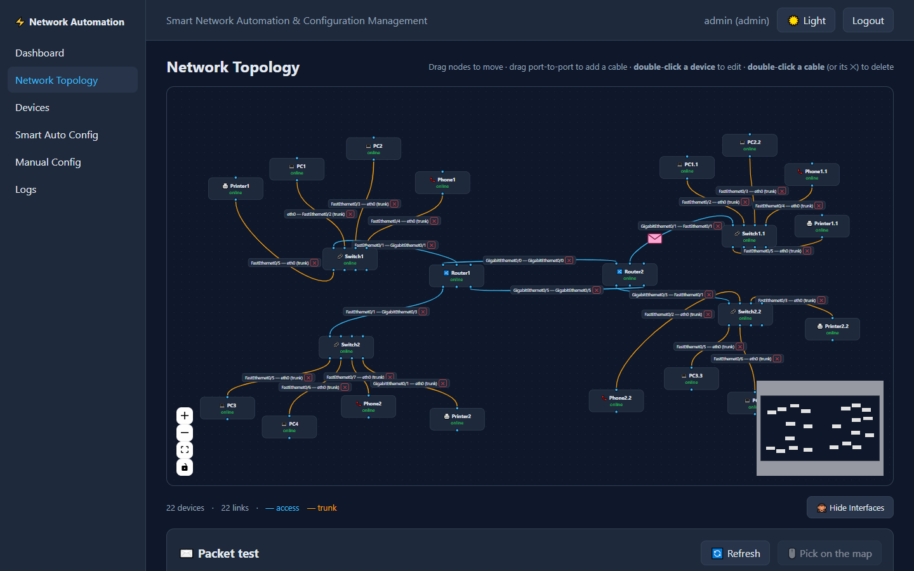
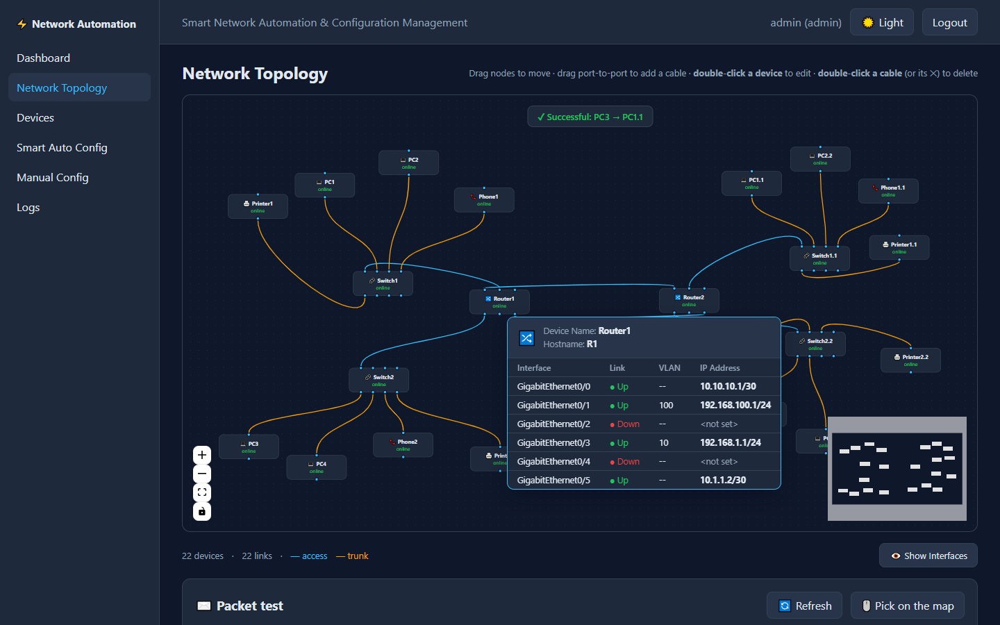
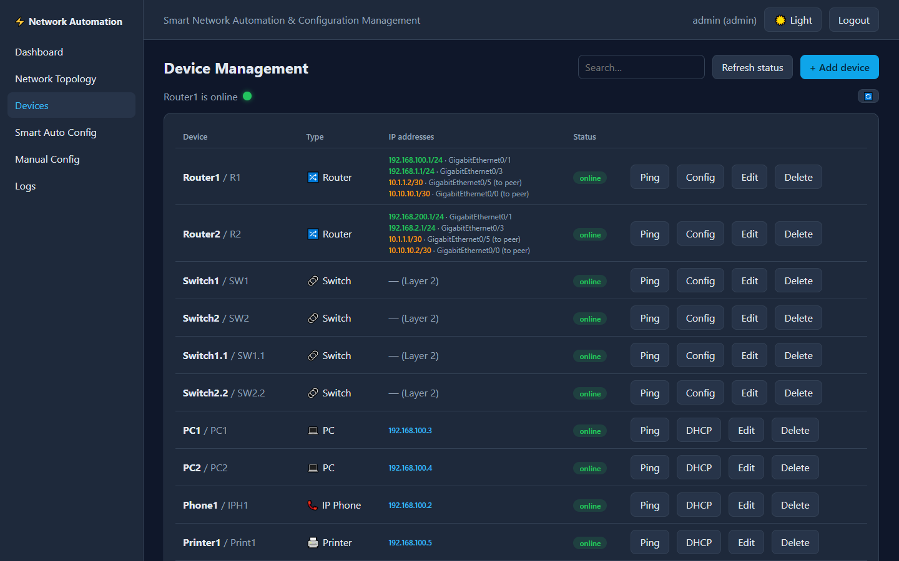
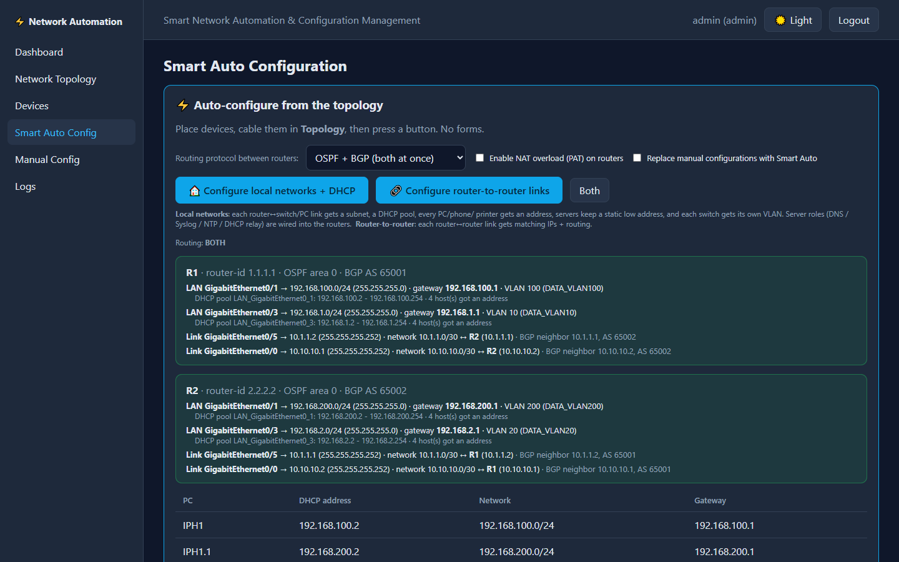

# ⚡ Smart Network Automation & Configuration Management Platform

**🇬🇧 English** · [🇦🇱 Shqip](README.sq.md)

Draw a Cisco network in the browser, press one button, and get the complete
**Cisco IOS configuration** for every router and switch: addresses, VLANs, DHCP,
OSPF / BGP and NAT. Then test it with an animated packet, without any lab.

Built as a master's thesis with Python / FastAPI, React, Jinja2, Netmiko and Ansible.
This repository is the **MVP** (minimum viable product) of the thesis.



**How it works, in three steps**

1. **Draw** – add devices and connect them with cables.
2. **Configure** – press a button in *Smart Auto Config* (or type it yourself in *Manual Config*).
3. **Test** – send a packet from one device to another and watch it travel.

---

## Contents

1. [Installation](#1-installation)
2. [Your first network in 5 minutes](#2-your-first-network-in-5-minutes)
3. [The pages](#3-the-pages)
4. [Smart Auto Config](#4-smart-auto-config)
5. [Manual Config](#5-manual-config)
6. [Testing the network](#6-testing-the-network)
7. [Rules the platform follows](#7-rules-the-platform-follows)
8. [Using the configuration on real devices](#8-using-the-configuration-on-real-devices)
9. [Architecture](#9-architecture)
10. [Database](#10-database)
11. [API](#11-api)
12. [Tests and the thesis experiment](#12-tests-and-the-thesis-experiment)
13. [Settings and security](#13-settings-and-security)
14. [Limitations and future work](#14-limitations-and-future-work)

---

## 1. Installation

**You need:** Windows, [Python 3.11, 3.12 or 3.13](https://www.python.org/downloads/) (3.14 and newer
do not work yet) and [Node.js 18+](https://nodejs.org/). Put the project in a short path, such as the Desktop.

### First time only

```powershell
git clone https://github.com/ArgjendEj/Smart-Network-Automation.git
cd Smart-Network-Automation\backend
python -m venv .venv
.\.venv\Scripts\python.exe -m pip install -r requirements.txt
```

### Every time

| To | Do this |
|---|---|
| **Start** | double-click `start.bat`. It opens **http://localhost:8000** (the first start also builds the interface, about 30 seconds) |
| **Stop** | double-click `stop.bat` |

Sign in with **`admin` / `admin123`**. On the first start the database is created with
four demo devices: R1, SW1, PC1 and PC2.

### For development

```powershell
# backend, restarts itself when the code changes
cd backend
.\.venv\Scripts\python.exe -m uvicorn main:app --reload --port 8000

# frontend, in a second terminal: http://localhost:5173
cd frontend
npm install
npm run dev
```

### If something does not work

| Problem | Solution |
|---|---|
| `start.bat` opens a page that cannot be reached | `backend\.venv` is missing: run the *First time only* steps |
| The page still looks old | press **Ctrl+F5** |
| Changed the frontend code, nothing happens | `cd frontend`, then `npm run build` |
| Changed the backend code, nothing happens | `stop.bat`, then `start.bat` |
| `pip` ends with *No such file or directory* and *Long Path* | the folder path is too long: move the project closer to `C:\` |
| `pip` cannot find a version of `pyyaml` | Python is too new: install 3.13 |
| Port 8000 is already in use | `stop.bat` ends whatever is running on it |

---

## 2. Your first network in 5 minutes

Uses the four demo devices of a new installation.

1. **Network Topology** – drag a cable from a blue dot of one device to a blue dot of another:
   `R1` → `SW1`, `SW1` → `PC1`, `SW1` → `PC2`. For the PCs the app asks *Trunk link?*: choose **Cancel** (access).
2. **Smart Auto Config** – choose **OSPF** and press **🏠 Configure local networks + DHCP**.

   ```
   R1 · router-id 1.1.1.1 · OSPF area 0
   LAN GigabitEthernet0/0 → 192.168.10.0/24 · gateway 192.168.10.2 · VLAN 100
   PC1 192.168.10.3      PC2 192.168.10.4
   ```
3. **Network Topology** – under the map, in **Packet test**, choose Source `PC1`, Destination `PC2`, press **Send**.
   The envelope travels PC1 → SW1 → PC2 and comes back with **✓ Successful**.
4. **Devices** – press **Config** next to `R1` or `SW1` to read the generated Cisco IOS.

---

## 3. The pages

| Page | What you can do |
|---|---|
| **Dashboard** | Number of devices, online / offline, VLANs · all addresses (*Network Addressing*) · recent activity |
| **Network Topology** | Draw the network · Packet test · Ping test |
| **Devices** | Add, edit, delete and search devices · **Ping** (online / offline) · **Config** (generated IOS) · **DHCP** (address for a PC) |
| **Smart Auto Config** | Configure the whole network with one button |
| **Manual Config** | Configure one router or switch yourself |
| **Logs** | Everything that happened, filtered by category |

Device types: **Router, Switch, PC, IP Phone, Printer, Server**.
The **☀️ Light / 🌙 Dark** button at the top changes the theme.

### On the topology map

| Action | Result |
|---|---|
| Drag a device | moves it |
| Drag from dot to dot | adds a cable |
| Rest the mouse on a device for 1 second | shows its interfaces, link, VLAN and IP |
| Double-click a device | opens *Edit device* |
| Double-click a cable (or its ✕) | deletes it |
| **Hide / Show Interfaces** | hides or shows the port names on the cables |

Blue cable = **access**, orange cable = **trunk**. A cable between routers and / or switches is always access.



### Colours of the IP addresses (Devices and Dashboard)

| Colour | Meaning |
|---|---|
| 🟢 Green | LAN gateway or management address |
| 🟠 Orange | router-to-router link, or any Class A address (`10.x.x.x`) |
| 🔵 Blue | address of a PC, phone, printer or server |

**(to peer)** appears when two devices are connected with two or more cables.



---

## 4. Smart Auto Config

Choose a routing protocol (**OSPF**, **BGP** or **both**), then press one of the buttons:

| Button | What it configures |
|---|---|
| 🏠 **Configure local networks + DHCP** | a subnet, gateway, VLAN and DHCP pool for every router ↔ switch / host cable, and an address for every host |
| 🔗 **Configure router-to-router links** | a `/30` on every router ↔ router cable, plus routing |
| **Both** | everything |

| Option | Meaning |
|---|---|
| **Enable NAT overload (PAT)** | the LANs are *inside*, the first router-to-router link is *outside* |
| **Replace manual configurations with Smart Auto** | also replaces the router addresses you typed yourself (see below) |



### What happens to what you typed yourself

| You typed it in | Smart Auto | Shown in the result |
|---|---|---|
| *Manual Config*: router interface + IP | keeps it | no |
| *Devices → Edit*: router interface IP | keeps it | yes |
| *Manual Config*: routing, DHCP, switch ports and VLANs | generates it again | yes |

Tick **Replace manual configurations** to let Smart Auto choose the router addresses as well.
Router-to-router links always become a `/30`.

Smart Auto **generates and saves** the configuration. It does not connect to any device;
see [section 8](#8-using-the-configuration-on-real-devices).

---

## 5. Manual Config

Choose a router or a switch, fill in only what you need and press **Generate configuration**.

| Device | You can set |
|---|---|
| **Router** | hostname · interfaces (IP, mask, up / down) · DHCP pools · OSPF · BGP |
| **Switch** | hostname · ports (access / trunk, VLAN) · VLANs. No IP address: a switch is Layer 2 here |

Tick **Deploy over SSH** to send it to a real router as well.
A network or broadcast address (for example `10.1.1.0/30`) is refused, with the addresses you can use instead.

---

## 6. Testing the network

| Test | Where | What it does |
|---|---|---|
| **✉️ Packet test** | Network Topology | An envelope travels along the cables, device by device, and returns **✓ Successful** or stops with **✕ Failed** and the reason. Choose the devices from the lists or with *Pick on the map* |
| **Ping test** | Network Topology, Devices | Enter two IP addresses: shows whether they reach each other and through which routers |
| **Ping** button | Devices | 🟢 online or 🔴 offline: the device answers on port 22 (SSH) or has a cable in the topology |

**Refresh** clears a test so you can start the next one.

> **Good to know:** Packet test and Ping test calculate the answer from the **cables and IP
> addresses**. They send nothing to real devices, and they do not check VLANs or whether
> OSPF / BGP is really running. For that, test in Packet Tracer, GNS3 or on real devices.

---

## 7. Rules the platform follows

### Addresses

| Network | Range | Notes |
|---|---|---|
| Local network | `192.168.X.0/24` | the gateway is `.1`, unless you typed another one |
| Router ↔ router | `10.0.0.0/8`, always `/30` | two cables between the same routers get two separate networks |
| Hosts | addresses right after the gateway | servers first, then PCs, phones and printers by hostname; running it again gives the same addresses |

### VLANs

| Network | VLAN |
|---|---|
| `192.168.X.0/24`, X below 100 | X × 10 (`192.168.1.0` → 10, `192.168.20.0` → 200) |
| `192.168.X.0/24`, X from 100 | X (`192.168.100.0` → 100); X × 10 if that number is already taken |
| Any other network | 100, 110, 120 … |

Every network has its own VLAN, the same on the router, the switch and in DHCP. All cabled
ports of a switch are in the VLAN of its LAN.

### Devices

- **Router:** six ports, `GigabitEthernet0/0` – `0/5`. Its configuration has no `vlan` or `switchport` commands.
- **Switch:** Layer 2 only, without an IP address. It may keep SSH credentials for the SSH block of its configuration.
- **PC, IP phone, printer:** get an address by DHCP. **Server:** keeps a fixed one.
- **Hosts** belong to the nearest switch that is cabled to a router.

### Routing and server roles

- **OSPF:** area 0, LAN interfaces are passive. **BGP:** one private AS per router, `65000 + device id`.

| Role of a server | Added to the routers |
|---|---|
| DNS | `dns-server` in the DHCP pools |
| DHCP | `ip helper-address` instead of a local pool |
| NTP | `ntp server` |
| Syslog | `logging host` |

Web and Monitoring are only labels.

---

## 8. Using the configuration on real devices

### Packet Tracer (or any console): copy and paste

1. **Devices → Config** next to the router or switch; copy the text.
2. On the device: `enable`, `configure terminal`, paste.

Packet Tracer cannot be reached over SSH from your computer, so copy and paste is the way there.

### GNS3, EVE-NG or real routers: SSH

1. Give the router an address your computer can reach, and enable SSH:

   ```
   hostname R1
   ip domain-name lab.local
   crypto key generate rsa modulus 1024
   username admin privilege 15 secret cisco
   enable secret cisco
   line vty 0 4
    transport input ssh
    login local
   ```

2. **Devices → Edit:** enter the Management IP, SSH username, password and enable secret.
3. **Manual Config:** tick **Deploy over SSH**. Only what you enter in that form is sent.

SSH deployment needs a management IP, so it works for **routers**. Set `DEPLOY_DRY_RUN=true`
in `backend/.env` to try it without sending anything.

### Ansible

Every SSH deployment also writes a `.cfg`, an inventory and a playbook to
`backend/automation/generated/`. To run them from Linux or WSL:

```bash
ansible-galaxy collection install cisco.ios
cd backend/automation/generated
ansible-playbook -i <name>.inventory.yml <name>.playbook.yml
```

---

## 9. Architecture

One server, one address: FastAPI also serves the React interface.

```
browser ──► http://localhost:8000
              ├── /        React interface (frontend/dist)
              ├── /docs    API documentation
              └── /api/*   FastAPI
                             ├── SQLite    backend/database/network.db
                             ├── Jinja2    templates → Cisco IOS
                             ├── Netmiko   SSH to routers
                             └── Ansible   inventory + playbook files
```

| Part | Technology |
|---|---|
| Backend | Python 3.11 – 3.13, FastAPI, SQLAlchemy 2, Pydantic 2, SQLite, JWT |
| Automation | Jinja2, Netmiko, generated Ansible files |
| Frontend | React 18, Vite, React Router, React Flow, Axios |

```
start.bat · stop.bat · server.vbs     start / stop on Windows

backend/
  main.py  config.py  database.py  models.py  schemas.py  seed.py  auth_utils.py
  routers/              API endpoints, one file per page
  services/
    auto_topology_service.py     Smart Auto: topology → addresses, VLANs, routing
    manual_config_service.py     Manual Config
    config_generator.py          renders the Cisco IOS text
    monitoring_service.py        Packet test and Ping test
    topology_service.py          map, cables, device information
    device_service.py            devices and their addresses
    dhcp_service.py              addresses for single hosts
    deployment_service.py        SSH (Netmiko) and Ansible files
    smart_config_service.py      department planner (API only)
    subnet_calculator.py  logging_service.py
  automation/templates/          Jinja2 templates (*.j2)
  tests/                         46 automated tests

frontend/src/
  pages/                Login, Register, Dashboard, Topology, Devices,
                        SmartConfiguration, ManualConfiguration, Logs
  components/           TopologyCanvas, DeviceNode, ConnectionLine, DeviceTooltip,
                        PacketTest, PacketEnvelope, PingTest, DeviceForm,
                        DeviceTable, ThemeToggle, …
  services/api.js       all calls to the backend

tests/                  thesis experiment
network_lab/            experiment results and figures
documentation/          database design, ER diagram, screenshots
```

---

## 10. Database

SQLite, seven tables. It is created on the first start and updates itself when a column is added.

| Table | Content |
|---|---|
| `users` | username, hashed password, role |
| `devices` | name, hostname, type, server roles, management IP, SSH credentials, position, status, last configuration |
| `connections` | the cables: both devices, both ports, access / trunk / p2p |
| `interfaces` | port, IP, mask, mode, VLAN, up / down |
| `vlans` | number, name, subnet, gateway |
| `routing` | OSPF / BGP, process or AS number, networks |
| `logs` | time, level, category, message, details |

More: [DatabaseDesign.md](documentation/DatabaseDesign.md) · [ERDiagram.md](documentation/ERDiagram.md)

---

## 11. API

Interactive documentation: **http://localhost:8000/docs** (press *Authorize* and sign in).

| Endpoint | Purpose |
|---|---|
| `POST /api/auth/login` · `register` · `logout` | accounts |
| `GET POST /api/devices` · `GET PUT DELETE /api/devices/{id}` | devices |
| `GET /api/devices/{id}/config` | generated Cisco IOS |
| `POST /api/devices/{id}/status` | online / offline |
| `GET /api/topology` · `POST DELETE /api/topology/connections` | map and cables |
| `GET /api/topology/devices/{id}/info` | interfaces, link, VLAN, IP |
| `POST /api/smart-config/auto` | Smart Auto Config |
| `POST /api/smart-config/preview` · `run` | department planner, not used by the interface |
| `POST /api/manual-config/run` | Manual Config |
| `POST /api/monitoring/packet` | Packet test |
| `POST /api/monitoring/ping` | Ping test: `design` (calculated), `server` (real ICMP) or `device` (over SSH) |
| `GET /api/dashboard` · `GET /api/logs` | dashboard and logs |

---

## 12. Tests and the thesis experiment

```powershell
cd backend
.\.venv\Scripts\python.exe -m pytest -q          # 46 tests
```

| File | Tests | Checks |
|---|---|---|
| `test_api.py` | 39 | accounts, devices, topology, Smart Auto, Manual Config, Packet test, Ping test |
| `test_subnet_calculator.py` | 4 | subnets |
| `test_config_generator.py` | 3 | Cisco IOS output |

The tests use a temporary database, never yours.

### Manual versus automatic

```powershell
backend\.venv\Scripts\python.exe tests\compare_manual_vs_auto.py     # from the project folder
backend\.venv\Scripts\python.exe tests\error_category_breakdown.py
```

| Departments | Manual time | Automatic time | Manual errors | Automatic errors |
|---|---|---|---|---|
| 2 | 508 s | 42 s | 3.03 | 0 |
| 4 | 824 s | 70 s | 3.77 | 0 |
| 6 | 1140 s | 98 s | 5.70 | 0 |
| 8 | 1456 s | 126 s | 6.37 | 0 |

How to read the numbers:

- **Manual** is an estimate: 4 s per IOS line, 90 s of subnet calculation per department, a 3 % chance
  of a mistake per line and 15 % per subnet calculation, averaged over 30 simulated runs.
- **Automatic** is the measured calculation time (a fraction of a second) plus an estimated 7 s for each
  form field the administrator fills in.
- The experiment uses the **department planner**, not the one-button topology mode.

Results: [comparison_results.md](network_lab/test_cases/comparison_results.md)

---

## 13. Settings and security

Copy `backend/.env.example` to `backend/.env` and change what you need:

| Setting | Meaning | Default |
|---|---|---|
| `SECRET_KEY` | signs the login tokens – **change it** | example text |
| `ADMIN_USERNAME`, `ADMIN_PASSWORD` | first account, created at start if it does not exist | `admin` / `admin123` |
| `ACCESS_TOKEN_EXPIRE_MINUTES` | how long you stay signed in | 480 |
| `DEPLOY_DRY_RUN` | `true`: never send anything to devices | `false` |
| `SSH_TIMEOUT` | seconds | 20 |
| `DATABASE_URL` | another database | SQLite file |

This is a thesis prototype for a lab, **not for production**:

- everyone who registers becomes an administrator;
- SSH passwords are stored unencrypted in the database and in the generated Ansible files (neither is in Git);
- account passwords are hashed (PBKDF2-SHA256);
- `start.bat` makes the server available on your own computer only (`127.0.0.1`).

---

## 14. Limitations and future work

- Smart Auto Config does not send its configuration to devices; use copy and paste, or Manual Config over SSH.
- Packet test and Ping test do not check VLANs or routing protocols.
- Not included yet: ACL editor, advanced STP, RIP, configuration backup and restore, user roles, live monitoring.
