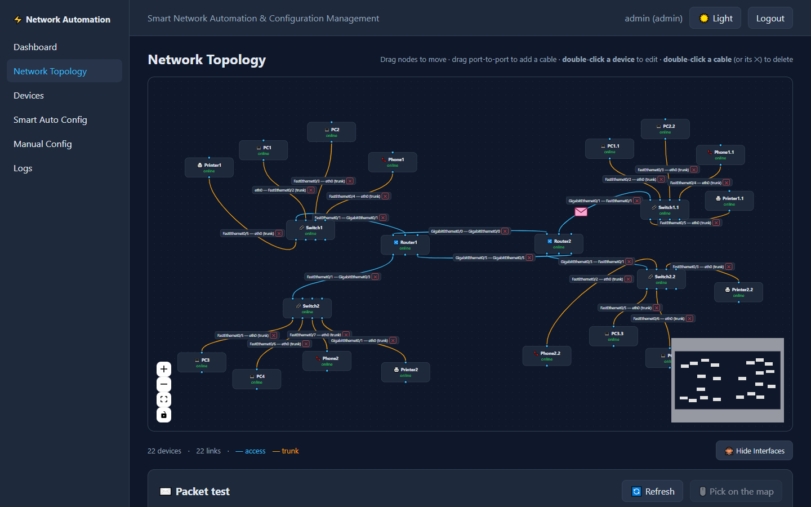
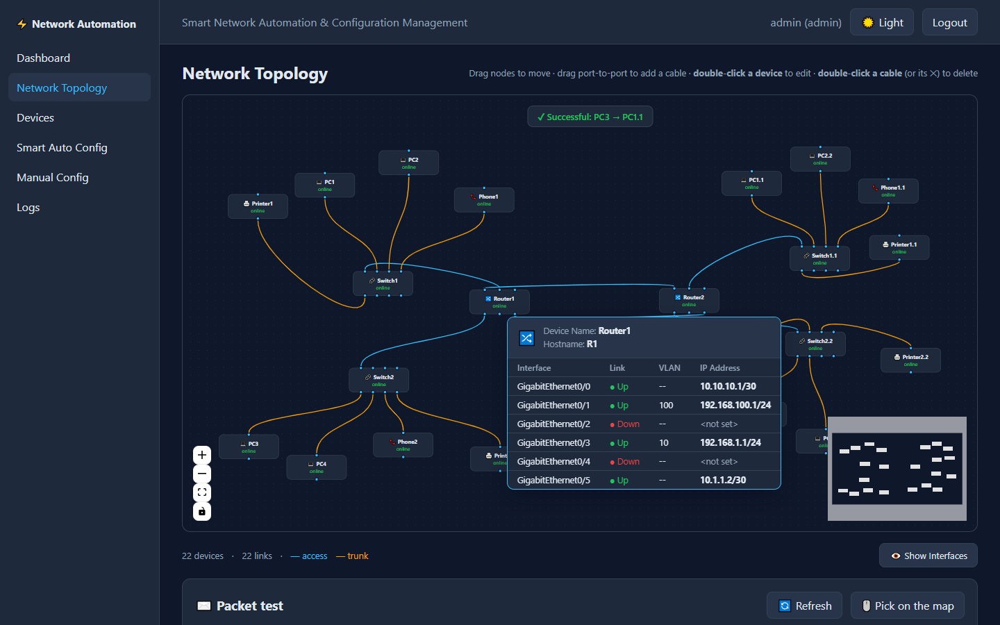
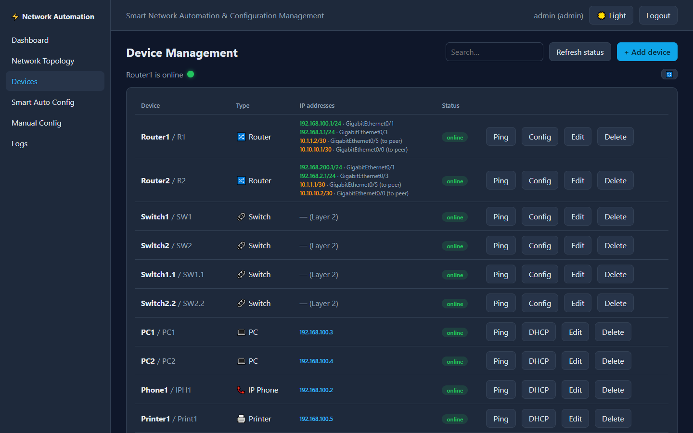
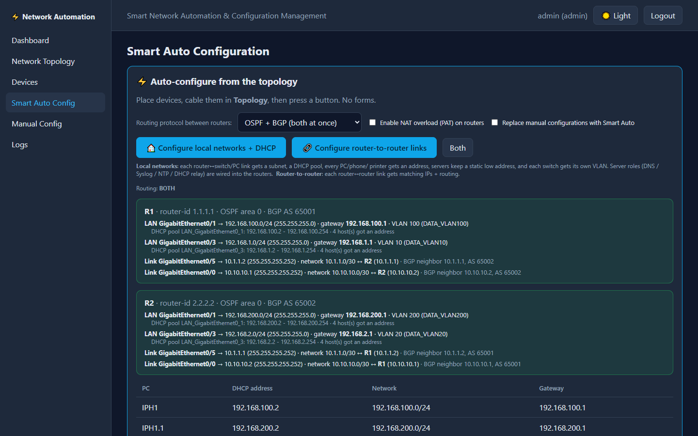

# ⚡ Platformë për Automatizimin dhe Menaxhimin e Konfigurimit të Rrjetit

[🇬🇧 English](README.md) · **🇦🇱 Shqip**

Vizato një rrjet Cisco në browser, kliko një buton dhe merr **konfigurimin e plotë
Cisco IOS** për çdo router dhe switch: adresat, VLAN-et, DHCP, OSPF / BGP dhe NAT.
Pastaj testoje me një paketë të animuar, pa pasur nevojë për lab.

E ndërtuar si temë masteri me Python / FastAPI, React, Jinja2, Netmiko dhe Ansible.
Ky repo është **MVP-ja** (versioni minimal funksional) i temës.



**Si funksionon, në tre hapa**

1. **Vizato** – shto pajisjet dhe lidhi me kabllo.
2. **Konfiguro** – kliko një buton te *Smart Auto Config* (ose shkruaje vetë te *Manual Config*).
3. **Testo** – dërgo një paketë nga një pajisje te tjetra dhe shihe duke udhëtuar.

---

## Përmbajtja

1. [Instalimi](#1-instalimi)
2. [Rrjeti yt i parë në 5 minuta](#2-rrjeti-yt-i-parë-në-5-minuta)
3. [Faqet](#3-faqet)
4. [Smart Auto Config](#4-smart-auto-config)
5. [Manual Config](#5-manual-config)
6. [Testimi i rrjetit](#6-testimi-i-rrjetit)
7. [Rregullat që ndjek platforma](#7-rregullat-që-ndjek-platforma)
8. [Përdorimi i konfigurimit në pajisje reale](#8-përdorimi-i-konfigurimit-në-pajisje-reale)
9. [Arkitektura](#9-arkitektura)
10. [Baza e të dhënave](#10-baza-e-të-dhënave)
11. [API](#11-api)
12. [Testet dhe eksperimenti i temës](#12-testet-dhe-eksperimenti-i-temës)
13. [Cilësimet dhe siguria](#13-cilësimet-dhe-siguria)
14. [Kufizimet dhe puna e ardhshme](#14-kufizimet-dhe-puna-e-ardhshme)

---

## 1. Instalimi

**Të duhen:** Windows, [Python 3.11, 3.12 ose 3.13](https://www.python.org/downloads/) (3.14 e më të rinj
ende nuk punojnë) dhe [Node.js 18+](https://nodejs.org/). Vendose projektin në një rrugë të shkurtër, p.sh. Desktop.

### Vetëm herën e parë

```powershell
git clone https://github.com/ArgjendEj/Smart-Network-Automation.git
cd Smart-Network-Automation\backend
python -m venv .venv
.\.venv\Scripts\python.exe -m pip install -r requirements.txt
```

### Çdo herë

| Për ta | Bëj këtë |
|---|---|
| **Nisur** | kliko dy herë `start.bat`. Hapet **http://localhost:8000** (herën e parë ndërtohet edhe ndërfaqja, rreth 30 sekonda) |
| **Ndalur** | kliko dy herë `stop.bat` |

Hyr me **`admin` / `admin123`**. Në nisjen e parë krijohet databaza me katër pajisje
shembull: R1, SW1, PC1 dhe PC2.

### Për zhvillim

```powershell
# backend-i, riniset vetë kur ndryshon kodi
cd backend
.\.venv\Scripts\python.exe -m uvicorn main:app --reload --port 8000

# frontend-i, në një terminal të dytë: http://localhost:5173
cd frontend
npm install
npm run dev
```

### Nëse diçka nuk punon

| Problemi | Zgjidhja |
|---|---|
| `start.bat` hap një faqe që nuk arrihet | mungon `backend\.venv`: bëj hapat *Vetëm herën e parë* |
| Faqja duket ende e vjetër | shtyp **Ctrl+F5** |
| Ndryshova kodin e frontend-it dhe nuk duket | `cd frontend`, pastaj `npm run build` |
| Ndryshova kodin e backend-it dhe nuk duket | `stop.bat`, pastaj `start.bat` |
| `pip` përfundon me *No such file or directory* dhe *Long Path* | rruga e dosjes është shumë e gjatë: zhvendose projektin më afër `C:\` |
| `pip` nuk gjen version të `pyyaml` | Python është shumë i ri: instalo 3.13 |
| Porti 8000 është i zënë | `stop.bat` mbyll çdo gjë që punon në të |

---

## 2. Rrjeti yt i parë në 5 minuta

Përdor katër pajisjet shembull të një instalimi të ri.

1. **Network Topology** – tërhiq një kabllo nga pika e kaltër e një pajisjeje te pika e kaltër e tjetrës:
   `R1` → `SW1`, `SW1` → `PC1`, `SW1` → `PC2`. Për PC-të aplikacioni pyet *Trunk link?*: zgjidh **Cancel** (access).
2. **Smart Auto Config** – zgjidh **OSPF** dhe kliko **🏠 Configure local networks + DHCP**.

   ```
   R1 · router-id 1.1.1.1 · OSPF area 0
   LAN GigabitEthernet0/0 → 192.168.10.0/24 · gateway 192.168.10.2 · VLAN 100
   PC1 192.168.10.3      PC2 192.168.10.4
   ```
3. **Network Topology** – poshtë hartës, te **Packet test**, zgjidh Source `PC1`, Destination `PC2` dhe kliko **Send**.
   Zarfi udhëton PC1 → SW1 → PC2 dhe kthehet me **✓ Successful**.
4. **Devices** – kliko **Config** te `R1` ose `SW1` për të lexuar Cisco IOS të gjeneruar.

---

## 3. Faqet

| Faqja | Çfarë mund të bësh |
|---|---|
| **Dashboard** | Numri i pajisjeve, online / offline, VLAN-et · të gjitha adresat (*Network Addressing*) · veprimet e fundit |
| **Network Topology** | Vizato rrjetin · Packet test · Ping test |
| **Devices** | Shto, ndrysho, fshi dhe kërko pajisje · **Ping** (online / offline) · **Config** (IOS i gjeneruar) · **DHCP** (adresë për një PC) |
| **Smart Auto Config** | Konfiguro tërë rrjetin me një buton |
| **Manual Config** | Konfiguro vetë një router ose switch |
| **Logs** | Gjithçka që ka ndodhur, e filtruar sipas kategorisë |

Llojet e pajisjeve: **Router, Switch, PC, IP Phone, Printer, Server**.
Butoni **☀️ Light / 🌙 Dark** lart e ndryshon pamjen.

### Në hartën e topologjisë

| Veprimi | Rezultati |
|---|---|
| Tërhiq një pajisje | e lëviz |
| Tërhiq nga pika te pika | shton një kabllo |
| Mbaje mausin 1 sekondë mbi një pajisje | tregon interfejsat, linkun, VLAN-in dhe IP-në |
| Klikim i dyfishtë mbi një pajisje | hap *Edit device* |
| Klikim i dyfishtë mbi një kabllo (ose ✕) | e fshin |
| **Hide / Show Interfaces** | fsheh ose shfaq emrat e porteve mbi kabllo |

Kabllo e kaltër = **access**, kabllo portokalli = **trunk**. Kablloja mes routerave dhe / ose switch-eve është gjithmonë access.



### Ngjyrat e adresave IP (Devices dhe Dashboard)

| Ngjyra | Kuptimi |
|---|---|
| 🟢 Jeshile | gateway i LAN-it ose adresë menaxhimi |
| 🟠 Portokalli | lidhje router-router, ose çdo adresë e Klasës A (`10.x.x.x`) |
| 🔵 E kaltër | adresa e një PC-je, telefoni, printeri ose serveri |

**(to peer)** del kur dy pajisje janë të lidhura me dy ose më shumë kabllo.



---

## 4. Smart Auto Config

Zgjidh protokollin e routing-ut (**OSPF**, **BGP** ose **të dyja**), pastaj kliko njërin nga butonat:

| Butoni | Çfarë konfiguron |
|---|---|
| 🏠 **Configure local networks + DHCP** | subnet, gateway, VLAN dhe DHCP pool për çdo kabllo router ↔ switch / pajisje fundore, dhe adresë për çdo pajisje fundore |
| 🔗 **Configure router-to-router links** | një `/30` në çdo kabllo router ↔ router, plus routing-un |
| **Both** | të gjitha |

| Opsioni | Kuptimi |
|---|---|
| **Enable NAT overload (PAT)** | LAN-et janë *inside*, lidhja e parë router-router është *outside* |
| **Replace manual configurations with Smart Auto** | zëvendëson edhe adresat e routerave që i ke shkruar vetë (shih më poshtë) |



### Çfarë ndodh me atë që e ke shkruar vetë

| E ke shkruar te | Smart Auto | Del te rezultati |
|---|---|---|
| *Manual Config*: interfejsi dhe IP-ja e routerit | e ruan | jo |
| *Devices → Edit*: IP-ja e interfejsit të routerit | e ruan | po |
| *Manual Config*: routing, DHCP, portet dhe VLAN-et e switch-it | i gjeneron përsëri | po |

Shëno **Replace manual configurations** që Smart Auto t'i zgjedhë edhe adresat e routerave.
Lidhjet router-router bëhen gjithmonë `/30`.

Smart Auto e **gjeneron dhe e ruan** konfigurimin. Nuk lidhet me asnjë pajisje;
shih [seksionin 8](#8-përdorimi-i-konfigurimit-në-pajisje-reale).

---

## 5. Manual Config

Zgjidh një router ose switch, plotëso vetëm atë që të duhet dhe kliko **Generate configuration**.

| Pajisja | Mund të vendosësh |
|---|---|
| **Router** | hostname · interfejsat (IP, maska, up / down) · DHCP pools · OSPF · BGP |
| **Switch** | hostname · portet (access / trunk, VLAN) · VLAN-et. Pa adresë IP: switch-i këtu është Layer 2 |

Shëno **Deploy over SSH** për ta dërguar edhe te një router real.
Adresa e rrjetit ose broadcast (p.sh. `10.1.1.0/30`) refuzohet, dhe tregohen adresat që mund të përdorësh.

---

## 6. Testimi i rrjetit

| Testi | Ku | Çfarë bën |
|---|---|---|
| **✉️ Packet test** | Network Topology | Një zarf udhëton nëpër kabllo, pajisje pas pajisjeje, dhe kthehet me **✓ Successful** ose ndalet me **✕ Failed** dhe arsyen. Pajisjet zgjidhen nga listat ose me *Pick on the map* |
| **Ping test** | Network Topology, Devices | Shkruaj dy adresa IP: tregon nëse arrihen dhe nëpër cilët routera |
| Butoni **Ping** | Devices | 🟢 online ose 🔴 offline: pajisja përgjigjet në portin 22 (SSH) ose ka kabllo në topologji |

**Refresh** e pastron testin që të nisësh tjetrin.

> **Duhet ta dish:** Packet test dhe Ping test e llogarisin përgjigjen nga **kabllot dhe adresat
> IP**. Nuk dërgojnë asgjë te pajisjet reale, dhe nuk kontrollojnë VLAN-et as nëse OSPF / BGP
> punon vërtet. Për këtë, testo në Packet Tracer, GNS3 ose në pajisje reale.

---

## 7. Rregullat që ndjek platforma

### Adresat

| Rrjeti | Diapazoni | Shënime |
|---|---|---|
| Rrjet lokal | `192.168.X.0/24` | gateway-i është `.1`, përveç kur ke shkruar një tjetër |
| Router ↔ router | `10.0.0.0/8`, gjithmonë `/30` | dy kabllo mes të njëjtëve routera marrin dy rrjete të ndara |
| Pajisjet fundore | adresat menjëherë pas gateway-it | së pari serverat, pastaj PC-të, telefonat dhe printerat sipas hostname-it; ekzekutimi i dytë jep të njëjtat adresa |

### VLAN-et

| Rrjeti | VLAN |
|---|---|
| `192.168.X.0/24`, X nën 100 | X × 10 (`192.168.1.0` → 10, `192.168.20.0` → 200) |
| `192.168.X.0/24`, X prej 100 | X (`192.168.100.0` → 100); X × 10 nëse ai numër është i zënë |
| Çdo rrjet tjetër | 100, 110, 120 … |

Çdo rrjet ka VLAN-in e vet, të njëjtë te routeri, te switch-i dhe te DHCP. Të gjitha portet me
kabllo të një switch-i janë në VLAN-in e LAN-it të tij.

### Pajisjet

- **Routeri:** gjashtë porte, `GigabitEthernet0/0` – `0/5`. Konfigurimi i tij nuk ka komanda `vlan` ose `switchport`.
- **Switch-i:** vetëm Layer 2, pa adresë IP. Mund të mbajë kredenciale SSH për bllokun SSH të konfigurimit.
- **PC, telefon IP, printer:** e marrin adresën me DHCP. **Serveri:** mban një adresë fikse.
- **Pajisjet fundore** i përkasin switch-it më të afërt që është i lidhur me router.

### Routing-u dhe rolet e serverit

- **OSPF:** area 0, interfejsat LAN janë passive. **BGP:** një AS privat për çdo router, `65000 + id e pajisjes`.

| Roli i serverit | Shtohet te routerat |
|---|---|
| DNS | `dns-server` te DHCP pools |
| DHCP | `ip helper-address` në vend të pool-it lokal |
| NTP | `ntp server` |
| Syslog | `logging host` |

Web dhe Monitoring janë vetëm etiketa.

---

## 8. Përdorimi i konfigurimit në pajisje reale

### Packet Tracer (ose çdo konsolë): kopjo dhe ngjit

1. **Devices → Config** te routeri ose switch-i; kopjo tekstin.
2. Në pajisje: `enable`, `configure terminal`, ngjite.

Packet Tracer nuk arrihet me SSH nga kompjuteri yt, prandaj aty përdoret kopjo dhe ngjit.

### GNS3, EVE-NG ose routera realë: SSH

1. Jepi routerit një adresë që e arrin kompjuteri yt dhe aktivizo SSH:

   ```
   hostname R1
   ip domain-name lab.local
   crypto key generate rsa modulus 1024
   username admin privilege 15 secret cisco
   enable secret cisco
   line vty 0 4
    transport input ssh
    login local
   ```

2. **Devices → Edit:** shkruaj Management IP, SSH username, password dhe enable secret.
3. **Manual Config:** shëno **Deploy over SSH**. Dërgohet vetëm ajo që shkruan në atë formë.

Dërgimi me SSH kërkon management IP, prandaj funksionon për **routera**. Vendos
`DEPLOY_DRY_RUN=true` te `backend/.env` për ta provuar pa dërguar asgjë.

### Ansible

Çdo dërgim me SSH shkruan edhe një `.cfg`, një inventory dhe një playbook te
`backend/automation/generated/`. Për t'i ekzekutuar nga Linux ose WSL:

```bash
ansible-galaxy collection install cisco.ios
cd backend/automation/generated
ansible-playbook -i <emri>.inventory.yml <emri>.playbook.yml
```

---

## 9. Arkitektura

Një server, një adresë: FastAPI shërben edhe ndërfaqen React.

```
browser ──► http://localhost:8000
              ├── /        ndërfaqja React (frontend/dist)
              ├── /docs    dokumentimi i API-së
              └── /api/*   FastAPI
                             ├── SQLite    backend/database/network.db
                             ├── Jinja2    template → Cisco IOS
                             ├── Netmiko   SSH te routerat
                             └── Ansible   skedarët inventory + playbook
```

| Pjesa | Teknologjia |
|---|---|
| Backend | Python 3.11 – 3.13, FastAPI, SQLAlchemy 2, Pydantic 2, SQLite, JWT |
| Automatizimi | Jinja2, Netmiko, skedarë Ansible të gjeneruar |
| Frontend | React 18, Vite, React Router, React Flow, Axios |

```
start.bat · stop.bat · server.vbs     nisja / ndalja në Windows

backend/
  main.py  config.py  database.py  models.py  schemas.py  seed.py  auth_utils.py
  routers/              endpoint-et e API-së, një skedar për faqe
  services/
    auto_topology_service.py     Smart Auto: topologjia → adresat, VLAN-et, routing-u
    manual_config_service.py     Manual Config
    config_generator.py          krijon tekstin Cisco IOS
    monitoring_service.py        Packet test dhe Ping test
    topology_service.py          harta, kabllot, informacioni i pajisjes
    device_service.py            pajisjet dhe adresat e tyre
    dhcp_service.py              adresa për pajisje të veçanta
    deployment_service.py        SSH (Netmiko) dhe skedarët Ansible
    smart_config_service.py      planifikuesi i departamenteve (vetëm API)
    subnet_calculator.py  logging_service.py
  automation/templates/          template-t Jinja2 (*.j2)
  tests/                         46 teste automatike

frontend/src/
  pages/                Login, Register, Dashboard, Topology, Devices,
                        SmartConfiguration, ManualConfiguration, Logs
  components/           TopologyCanvas, DeviceNode, ConnectionLine, DeviceTooltip,
                        PacketTest, PacketEnvelope, PingTest, DeviceForm,
                        DeviceTable, ThemeToggle, …
  services/api.js       të gjitha thirrjet te backend-i

tests/                  eksperimenti i temës
network_lab/            rezultatet dhe figurat e eksperimentit
documentation/          dizajni i databazës, diagrami ER, pamjet
```

---

## 10. Baza e të dhënave

SQLite, shtatë tabela. Krijohet në nisjen e parë dhe përditësohet vetë kur shtohet një kolonë.

| Tabela | Përmbajtja |
|---|---|
| `users` | username, fjalëkalimi i hashuar, roli |
| `devices` | emri, hostname, lloji, rolet e serverit, management IP, kredencialet SSH, pozicioni, statusi, konfigurimi i fundit |
| `connections` | kabllot: dy pajisjet, dy portet, access / trunk / p2p |
| `interfaces` | porti, IP, maska, mode, VLAN, up / down |
| `vlans` | numri, emri, subnet-i, gateway-i |
| `routing` | OSPF / BGP, numri i procesit ose AS, rrjetet |
| `logs` | koha, niveli, kategoria, mesazhi, detajet |

Më shumë: [DatabaseDesign.md](documentation/DatabaseDesign.md) · [ERDiagram.md](documentation/ERDiagram.md)

---

## 11. API

Dokumentimi interaktiv: **http://localhost:8000/docs** (kliko *Authorize* dhe hyr).

| Endpoint-i | Qëllimi |
|---|---|
| `POST /api/auth/login` · `register` · `logout` | llogaritë |
| `GET POST /api/devices` · `GET PUT DELETE /api/devices/{id}` | pajisjet |
| `GET /api/devices/{id}/config` | Cisco IOS i gjeneruar |
| `POST /api/devices/{id}/status` | online / offline |
| `GET /api/topology` · `POST DELETE /api/topology/connections` | harta dhe kabllot |
| `GET /api/topology/devices/{id}/info` | interfejsat, linku, VLAN-i, IP-ja |
| `POST /api/smart-config/auto` | Smart Auto Config |
| `POST /api/smart-config/preview` · `run` | planifikuesi i departamenteve, nuk përdoret nga ndërfaqja |
| `POST /api/manual-config/run` | Manual Config |
| `POST /api/monitoring/packet` | Packet test |
| `POST /api/monitoring/ping` | Ping test: `design` (i llogaritur), `server` (ICMP real) ose `device` (me SSH) |
| `GET /api/dashboard` · `GET /api/logs` | dashboard dhe logs |

---

## 12. Testet dhe eksperimenti i temës

```powershell
cd backend
.\.venv\Scripts\python.exe -m pytest -q          # 46 teste
```

| Skedari | Teste | Çfarë kontrollon |
|---|---|---|
| `test_api.py` | 39 | llogaritë, pajisjet, topologjinë, Smart Auto, Manual Config, Packet test, Ping test |
| `test_subnet_calculator.py` | 4 | subnet-et |
| `test_config_generator.py` | 3 | tekstin Cisco IOS |

Testet përdorin një databazë të përkohshme, asnjëherë tënden.

### Manual kundrejt automatikut

```powershell
backend\.venv\Scripts\python.exe tests\compare_manual_vs_auto.py     # nga dosja e projektit
backend\.venv\Scripts\python.exe tests\error_category_breakdown.py
```

| Departamente | Koha manuale | Koha automatike | Gabime manuale | Gabime automatike |
|---|---|---|---|---|
| 2 | 508 s | 42 s | 3.03 | 0 |
| 4 | 824 s | 70 s | 3.77 | 0 |
| 6 | 1140 s | 98 s | 5.70 | 0 |
| 8 | 1456 s | 126 s | 6.37 | 0 |

Si lexohen numrat:

- **Manual** është vlerësim: 4 s për rresht IOS, 90 s llogaritje subnet-i për departament, 3 % mundësi
  gabimi për rresht dhe 15 % për llogaritje subnet-i, mesatarja e 30 simulimeve.
- **Automatik** është koha e matur e llogaritjes (një pjesë e sekondës) plus 7 s të vlerësuara për çdo
  fushë që plotëson administratori.
- Eksperimenti përdor **planifikuesin e departamenteve**, jo mënyrën me një buton nga topologjia.

Rezultatet: [comparison_results.md](network_lab/test_cases/comparison_results.md)

---

## 13. Cilësimet dhe siguria

Kopjo `backend/.env.example` si `backend/.env` dhe ndrysho çfarë të duhet:

| Cilësimi | Kuptimi | Parazgjedhja |
|---|---|---|
| `SECRET_KEY` | nënshkruan tokenat e hyrjes – **ndryshoje** | tekst shembull |
| `ADMIN_USERNAME`, `ADMIN_PASSWORD` | llogaria e parë, krijohet në nisje nëse nuk ekziston | `admin` / `admin123` |
| `ACCESS_TOKEN_EXPIRE_MINUTES` | sa kohë mbetesh i kyçur | 480 |
| `DEPLOY_DRY_RUN` | `true`: nuk dërgon kurrë asgjë te pajisjet | `false` |
| `SSH_TIMEOUT` | sekonda | 20 |
| `DATABASE_URL` | një databazë tjetër | skedar SQLite |

Ky është prototip i temës për lab, **jo për prodhim**:

- kushdo që regjistrohet bëhet administrator;
- fjalëkalimet SSH ruhen të pakriptuara në databazë dhe te skedarët Ansible (asnjëra nuk është në Git);
- fjalëkalimet e llogarive janë të hashuara (PBKDF2-SHA256);
- `start.bat` e hap serverin vetëm në kompjuterin tënd (`127.0.0.1`).

---

## 14. Kufizimet dhe puna e ardhshme

- Smart Auto Config nuk e dërgon konfigurimin te pajisjet; përdor kopjo dhe ngjit, ose Manual Config me SSH.
- Packet test dhe Ping test nuk kontrollojnë VLAN-et as protokollet e routing-ut.
- Ende nuk përfshihen: editor ACL, STP i avancuar, RIP, backup dhe restore i konfigurimit, role përdoruesish, monitorim i drejtpërdrejtë.
